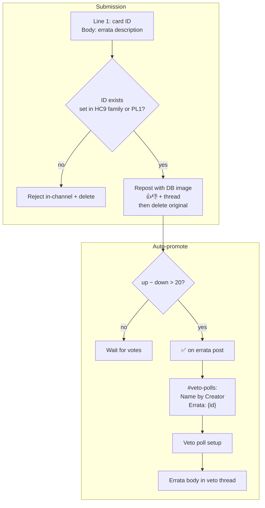
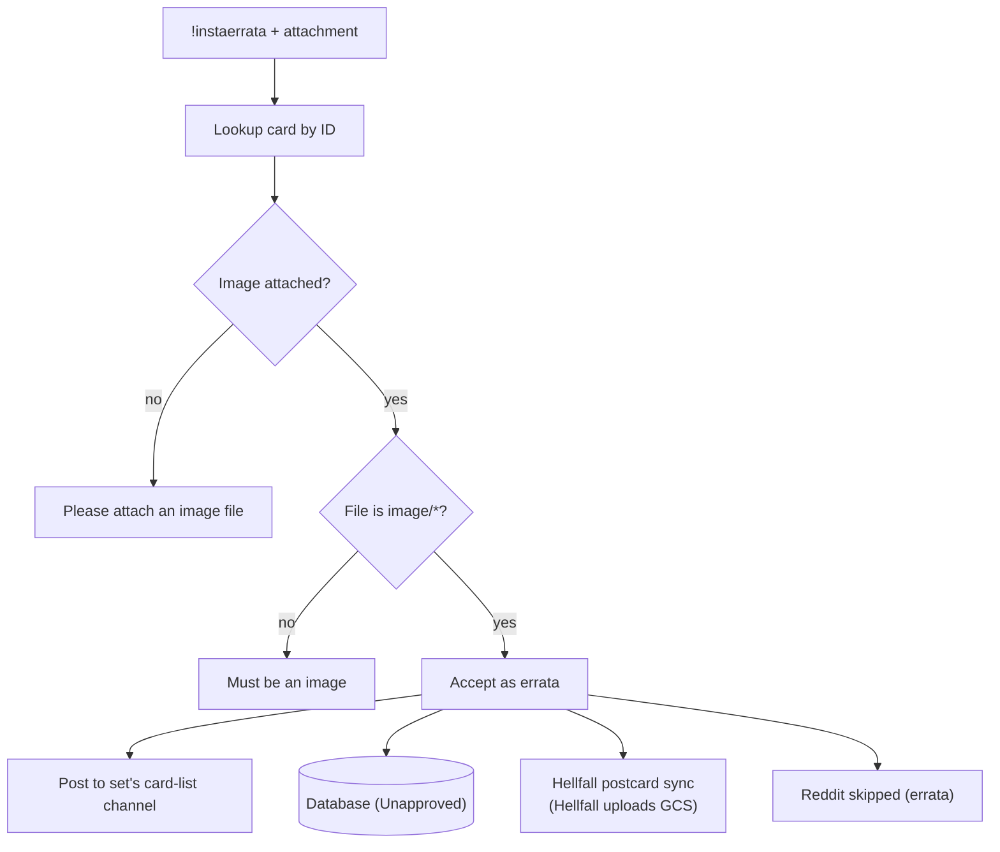

# Errata

[← Card flows](README.md)

## Errata submission (`#errata-submissions`)

**Entry:** `on_message` for `ERRATA_SUBMISSIONS` · background auto-promote every 5 min (same channel)



Allowed sets are resolved via catalog set children of `CUBE_NAME` (`HC9`, `HC9_0`, `HC9_1`, …) plus `PL1`. Rejection pings go in `#errata-submissions` so the submitter sees them.

Auto-promote scans the last **14 days**, up to **200 messages**.

Hellpit resubmits still land in `#errata-tracking` (`ERRATA_TRACKING`) with ☑️ — that path is separate from user intake.

---

## Admin instant errata

**Entry:** `!instaerrata` (admin or instaerrata-review role) with attachment + text:

```
Cardname by Author
Errata: <card id>
```


