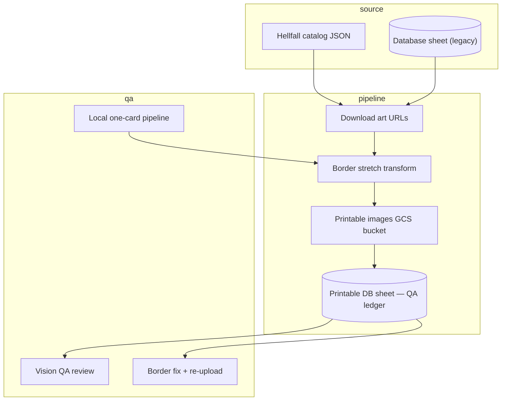
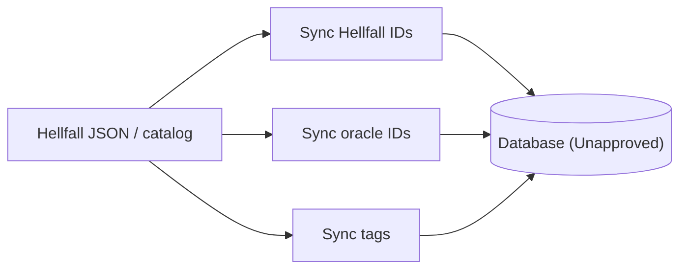
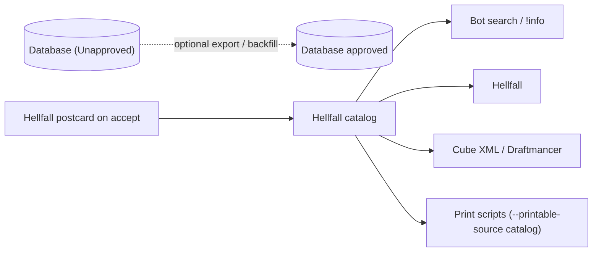

# Scripts & percolation

[← Card flows](README.md)

Misc card handling stuff, like the printabledb workflow

## Printable / printing pipeline

**Preferred source:** Hellfall catalog (`--printable-source catalog` on
[`scripts/download_and_upload_images_gcs.py`](../../scripts/download_and_upload_images_gcs.py)).
The Printable DB sheet remains the QA ledger (append/update after GCS upload).

Legacy **sheet** mode (`--printable-source sheet`, default) still scans the approved Database tab.



Example (printable only, catalog):

```bash
python scripts/download_and_upload_images_gcs.py --printable-only --printable-source catalog
```

---

## Hellfall / catalog sync



Card acceptance also writes Hellfall UUID and oracle_id on accept via postcard sync.

---

## Manual mod percolation (retired)

**Retired** for normal ops once Hellfall postcard is the approval path: accepted cards land in the
catalog without a mod transcribing unapproved → approved Database.

The unapproved/approved sheets may still receive optional dual-writes for export/backfill; do not
treat manual copy as a required step for search, Hellfall, or printables.


