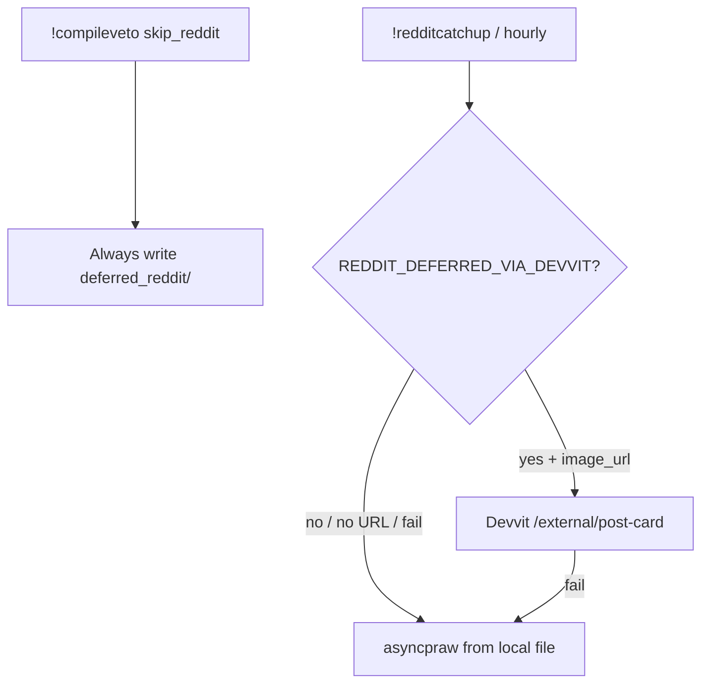

# hellscube-bridge — deferred Reddit posting

Mork always owns the backlog in `deferred_reddit/` (local image + manifest, including Hellfall `image_url` when available). `REDDIT_DEFERRED_VIA_DEVVIT` only switches **who posts** on catchup: Devvit `/external/post-card` vs asyncpraw.

`!compileveto` overflow never enqueues to Devvit Redis.

## Catchup path

## Mork flags

| Env | Default | Behavior |
| --- | ------- | -------- |
| `REDDIT_DEFERRED_VIA_DEVVIT=1` | off | Catchup posts via `/external/post-card` when the manifest has `image_url`; asyncpraw fallback |
| unset / `0` | — | Catchup posts via asyncpraw from local files only |

Pending count is always the Mork filesystem backlog.

## On-demand test (after flag + restart)

Veto discussion channel only:

| Command | Effect |
| --- | --- |
| `!redditcatchup` or `!redditcatchup 0` | Status only: Mork pending + transport (`Devvit post-card` or `asyncpraw`) |
| `!redditcatchup 1` | Drain **one** live post from `deferred_reddit/` |

Items without `image_url` (older backlog) still use asyncpraw even when the flag is on.

## Legacy Devvit Redis endpoints (unused by Mork)

hellscube-bridge still ships `/external/deferred-{enqueue,drain,status}` and the mod menu **Post 1 deferred Reddit card**. Mork no longer writes or drains that Redis queue; leave it unused unless you probe those endpoints manually.

## Cutover

1. `DEVVIT_POST_CARD_*` on the VM (same token as other external posts).
2. Set `REDDIT_DEFERRED_VIA_DEVVIT=1` and restart Mork.
3. In veto discussion: `!redditcatchup` → confirm `transport=Devvit post-card`, then `!redditcatchup 1` when ready.
4. New compileveto batches store `image_url` and can post via Devvit; drain old filesystem-only rows with asyncpraw as needed.
